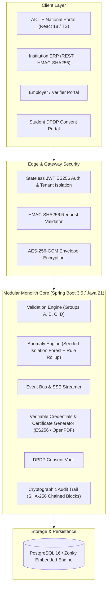
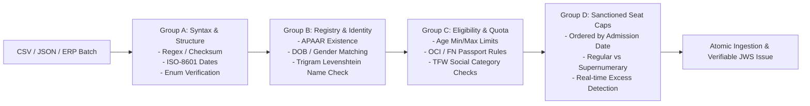

# VidyaSetu — System Architecture & Technical Specifications

**VidyaSetu** is an enterprise-grade Student Data Management & Verification System designed for the All India Council for Technical Education (AICTE), Ministry of Education, Government of India.

It establishes an authoritative, real-time, privacy-preserving single source of truth for technical education enrolments anchored to the national **APAAR ID (Automated Permanent Academic Account Registry)**.

---

## 1. High-Level Architectural Topology

---

## 2. Ingestion & Multi-Stage Validation Pipeline

Student ingestion operates across four defensive validation groups:

### Validation Groups:
- **Group A (Syntactic & Format Checks):** Validates 12-digit APAAR format, ISO dates, phone numbers, and structural schema completeness.
- **Group B (Identity & Registry Verification):** Interfaces with APAAR registry mock/adapter; computes Levenshtein fuzzy string distance for student name discrepancies.
- **Group C (Academic & Quota Eligibility):** Checks minimum age requirements (>= 14 years), foreign national passport verification, and Tuition Fee Waiver (TFW) rules.
- **Group D (Seat Cap Allocation & Excess Detection):** Sorts admissions strictly by `admission_date ASC`. When regular intake reaches 100%, subsequent admissions are categorized as `seat_class = EXCESS`, immediately raising a `CRITICAL` institutional breach.

---

## 3. Cryptographic Audit Trail (SHA-256 Hash Chain)

Every security event, batch ingestion, waiver, and identity lookup is appended to an immutable audit log. Each row computes its cryptographic hash over the prior block's hash:

$$\text{Hash}_n = \text{SHA-256}\left(\text{Hash}_{n-1} \,\|\, \text{Timestamp} \,\|\, \text{Actor} \,\|\, \text{Action} \,\|\, \text{EntityID} \,\|\, \text{Payload}\right)$$

### Tamper-Proof Guarantees:
- Database triggers strictly prohibit `UPDATE` or `DELETE` on the `audit_log` table.
- The `GET /api/v1/audit/verify-chain` endpoint traverses the chain from the genesis block (`0000000000000000000000000000000000000000000000000000000000000000`) to the tip. If any row is modified out-of-band, the verification algorithm immediately isolates the compromised block ID.

---

## 4. Verifiable Credentials & Selective Disclosure

### Cryptographic JWS Records
- Issued records conform to RFC 7515 (Compact JWS) signed using **ES256 (ECDSA using P-256 curve and SHA-256)**.
- Platform public keys are published in standard JWKS format at `/api/v1/public/jwks.json`, enabling offline, decentralized verification by universities and overseas employers without contacting AICTE servers.

### DPDP Act 2023 Tiered Disclosure Matrix
| Tier | Access Scope | Consent Requirement | Data Disclosed |
|---|---|---|---|
| **PUBLIC** | Anyone with JTI link or QR code | None | Issuing institution, program code, academic year, status, masked APAAR (`XXXX XXXX 1234`) |
| **Tier L1** | Registered Verifiers | Purpose logged | Enrolment status, verified intake classification |
| **Tier L2** | Background Checkers / Employers | **Active Student Consent** | Legal full name, date of birth, institute student ID |
| **Tier L3** | Regulatory Authorities & AICTE | Legal Mandate / MFA | Complete audit trail, residency, category, contact history |

---

## 5. Machine Learning Anomaly Detection (Isolation Forest)

VidyaSetu features a self-contained, zero-dependency **Isolation Forest** implementation written in pure Java.
- **Features Extracted per Institution:**
  1. Intake fill ratio ($E / C$)
  2. Late admission clustering ratio ($\% \text{ within last 5 days}$)
  3. Off-hour admission submission ratio ($22:00 - 06:00$)
  4. Supernumerary quota utilization ratio
  5. Multi-institution duplicate velocity
- **Explainability:** Anomaly scores ($0.0 - 1.0$) are augmented with human-readable diagnostic explanations for AICTE inspectors.

---

## 6. Offline-First & Deployment Flexibility
- **Standard Mode:** Production Docker Compose running Spring Boot, React Nginx, and PostgreSQL 16.
- **Embedded Zero-Config Mode:** When Docker Desktop or host databases are unavailable, the application boots into the `local-embedded` Spring profile, starting a full in-memory Zonky PostgreSQL database with automated Flyway schema initialization.
