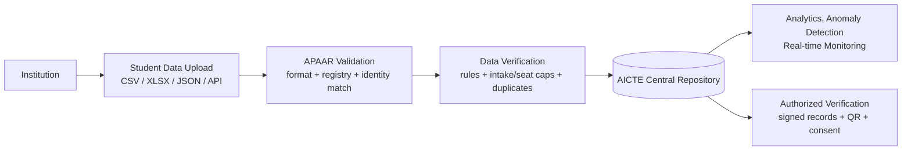
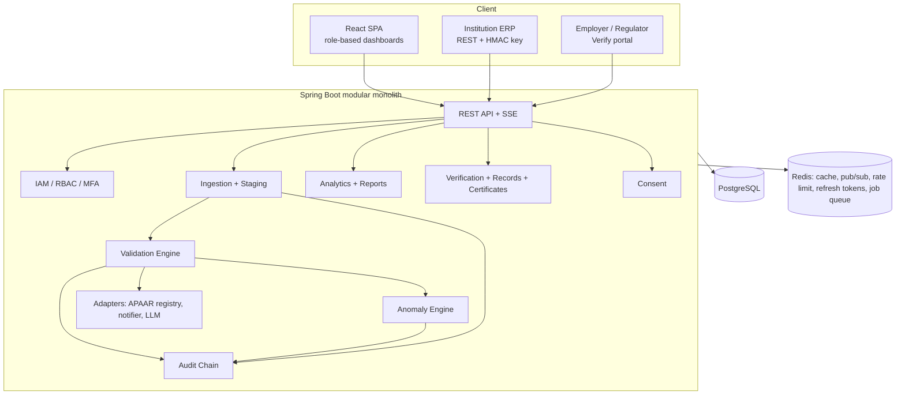

# VidyaSetu — APAAR-based Student Data Management & Verification System
### Master plan and execution playbook for the building agent

Codename: **VidyaSetu**. Target: a complete, demo-ready, AICTE-portal-integrable prototype that satisfies all 10 requirements of the problem statement and goes beyond them (intelligent anomaly detection, signed verifiable records, real-time monitoring).

---

## 0. READ THIS FIRST — operating contract

You are an autonomous senior engineer. The human will not answer questions or review intermediate steps. Follow these rules for the whole build.

1. **Never ask the human anything.** When something is ambiguous, pick the most reasonable option, write it to `docs/DECISIONS.md` (one line: decision, why, date), and keep going.
2. **Offline-first.** The demo must run with zero internet and zero paid keys. Every external system (APAAR registry, DigiLocker, e-mail/SMS, LLM) sits behind an interface with a working **mock default**. Real adapters are optional extras, disabled by default.
3. **Try-then-ignore for external APIs.** If you want to use a public API or dataset: spend at most 10 minutes testing it. If it works without credentials and is stable, you may add it as an *optional* adapter. If it fails, needs a key, or is rate-limited, drop it and use the mock. Never block on it. Never make the demo depend on it.
4. **Verify before moving on.** Each phase in §18 has verify commands. Do not start the next phase while the build or tests are red. Commit after each green phase (`git commit -m "phase N: ..."`).
5. **No real personal data. Never store Aadhaar numbers.** All data is synthetic. The UI shows a persistent "SYNTHETIC DEMO DATA" banner when `app.demo-mode=true`.
6. **Fallback ladder (§21).** If a feature is eating time, ship the simpler fallback, note it in `DECISIONS.md`, and continue. A finished simple system beats an unfinished ambitious one.
7. **Definition of done** is §19 (acceptance matrix) fully green plus `scripts/smoke.sh` passing from a clean checkout with `docker compose up`.
8. Final deliverable: a repo that a stranger can run with **one command** and demo in 7 minutes using `docs/DEMO_SCRIPT.md`.

---

## 1. Feasibility verdict and source register

**Verdict: yes, fully buildable as a prototype.** Everything the problem statement asks for is standard web/data engineering plus open-source libraries. The only thing that cannot be done for real is live verification against the national APAAR registry — that is government-gated. So the design treats the registry as a **pluggable adapter with a high-fidelity mock**, which is also the honest and credible way to present it to judges.

### What was researched (and what it means)

| Topic | Finding | Design consequence |
|---|---|---|
| APAAR ID format | A 12-digit unique, lifelong academic ID, created via DigiLocker / ABC portal / UDISE+, linked to ABC and DigiLocker. Official site: https://apaar.education.gov.in | Structural validation = exactly 12 digits. **No public checksum is documented** (the Verhoeff checksum belongs to Aadhaar, not APAAR) — do not invent one. |
| Public APAAR verification API | No open, keyless endpoint found. Official creation/verification is available to institutions through DigiLocker/ABC/UDISE+ onboarding. Paid third-party wrappers exist (e.g. https://meon.co.in/apaar-card-verification-api). Not testable without credentials. | `ApaarRegistryClient` interface; `MockApaarRegistryClient` is default. `DigiLockerAbcClient` and `ThirdPartyApaarClient` are **stub adapters** (config-flagged, documented, not required). |
| Supernumerary seat rules | 15% over and above approved intake for Foreign Nationals / OCI / PIO / Children of Indian Workers in Gulf countries (CIWGC); one-third of that 15% is for CIWGC and vacancies interchange between the two pools (https://ajce.in/home/intnladmissions.html). Worked example of per-branch numbers: https://admissions.pict.edu/international.php. APH 2018-19 text also lists 5% Tuition Fee Waiver (TFW) as supernumerary. | Seat-cap rules are encoded as **editable policy config**, not hard-coded (§9, Appendix C). NRI quota is counted *within* approved intake; its percentage cap varies by state notification, so the default is a **WARN-level** rule and configurable. |
| Under-enrolment signal | AICTE EoA letters reduce approved intake where admissions are ≤30% of intake consistently for 5 years (e.g. https://smvec.ac.in/wp-content/uploads/2026/06/EOA-Report-2025-26.pdf). | Direct input for the "chronic under-enrolment" anomaly detector. |
| AICTE institution data | AICTE publishes approvals and a bulk list of approved institutions on aicte-india.org; EoA letters carry an application number of the form `1-<digits>`. | Institution master data is modelled on this (AICTE ID, program, approved intake). Demo uses **fictional institutions** (never real names with fake numbers). If the agent can fetch the bulk list keylessly it may add an optional CSV importer; the demo does not depend on it. |

### Real vs simulated (put this table in the submission docs — judges respect it)

| Component | Prototype | Production path |
|---|---|---|
| APAAR registry lookup | Mock registry table seeded with synthetic IDs | DigiLocker/ABC/UDISE+ adapter via MoE/NeGD onboarding |
| Student login | APAAR ID + demo OTP `123456` | DigiLocker OAuth / mobile OTP |
| AICTE portal integration | REST + signed-webhook + bulk upload endpoints, OpenAPI | Same APIs behind AICTE API gateway/SSO |
| E-mail/SMS | Logged to console + in-app inbox | SMTP/SMS gateway |
| Anomaly "explanations" | Template text (default) | Optional Spring AI + Gemini/OpenAI, PII-free feature summaries |

---

## 2. Product definition

**Pipeline (mirrors the problem statement exactly):**



**Personas:** AICTE Admin, AICTE Analyst, AICTE Auditor, Institution Admin, Institution Operator, Regulator (UGC/NBA/NAAC/State), Employer Verifier, Student, ERP/API Client.

**In scope:** all 10 requirements, plus: remediation worklists, explainable institution risk score, tamper-evident audit chain, offline-verifiable signed records, student consent management, certificate PDF with APAAR ID + Student ID + QR.

**Out of scope:** real Aadhaar/DigiLocker calls, payments, fee collection, academic marks/credits (ABC's job), mobile apps.

---

## 3. Architecture

Modular monolith (fast to build, clean module boundaries, can be split later).



**Key flows**

1. *Upload:* file/JSON → `upload_batches` + `staging_rows` → async job (virtual threads) → per-row validation → accepted rows upserted into `enrolments` → batch-level seat/intake checks → anomaly refresh for touched (institution, program, year) → events published → dashboards update live over SSE.
2. *Verify:* verifier submits APAAR ID (or scans QR) → consent + role check → scoped response (§12) → logged in `verification_requests` and `audit_log`.
3. *Resolve:* issue → institution fixes/resubmits or acknowledges → AICTE can waive with a note → audit entry.

---

## 4. Technology stack (open-source only)

| Layer | Choice | Notes |
|---|---|---|
| Language/runtime | Java 21 (or newest LTS available), virtual threads | |
| Backend | Spring Boot 3.x latest GA (Web, Security, Data JPA, Validation, Actuator, Cache) | pin latest stable at build time |
| DB | PostgreSQL 16+ with `pg_trgm` (fuzzy match), `pgcrypto` optional | Flyway migrations |
| Cache/bus | Redis 7 | cache, pub/sub for SSE, Bucket4j rate limits, refresh-token store, job queue |
| Security | Spring Security, JWT (Nimbus JOSE, ES256), Argon2/BCrypt, TOTP (`dev.samstevens.totp`) for AICTE admins | |
| Files | Apache POI (XLSX), Apache Commons CSV, Jackson | |
| PDF + QR | OpenPDF (or Apache PDFBox) + ZXing | |
| Fuzzy text | Apache Commons Text (JaroWinkler, Levenshtein) + `pg_trgm` | |
| Anomaly ML | **Own lightweight Isolation Forest in Java** (~150 lines, seeded RNG) + robust stats | Avoids GPL dependency (Smile is GPL). |
| AI (optional) | Spring AI + Gemini/OpenAI for natural-language anomaly summaries | Off by default; template fallback |
| API docs | springdoc-openapi (Swagger UI at `/swagger-ui.html`) | |
| Tests | JUnit 5, Mockito, Testcontainers (fallback: `io.zonky.test:embedded-postgres`), RestAssured | |
| Frontend | React + Vite + TypeScript, Tailwind CSS, shadcn/ui, TanStack Query + Router, Recharts, react-hook-form + zod, PapaParse (client CSV preview), `@microsoft/fetch-event-source` (SSE with auth header), html5-qrcode (QR scan) | |
| Ops | Docker Compose (postgres, redis, backend, frontend/nginx, mailhog optional), Makefile | |

---

## 5. Repository layout

```
vidyasetu/
├─ README.md
├─ docker-compose.yml          # one command: docker compose up --build
├─ Makefile                    # make up | down | seed | test | smoke | reset-demo
├─ .env.example
├─ backend/
│  ├─ pom.xml
│  └─ src/main/java/com/vidyasetu/
│     ├─ common/ (errors RFC7807, pagination, masking utils, time)
│     ├─ iam/ masterdata/ apaar/ ingestion/ validation/ anomaly/
│     ├─ analytics/ realtime/ verification/ reporting/ integration/
│     ├─ consent/ audit/
│     └─ VidyaSetuApplication.java
│  └─ src/main/resources/db/migration/V001__*.sql ...
│  └─ src/test/java/... (unit + integration + scenario tests)
├─ frontend/ (Vite app)
├─ seed/
│  ├─ generator/ (deterministic generator, used by backend `seed` profile)
│  ├─ demo_upload_clean.csv
│  ├─ demo_upload_dirty.csv
│  ├─ demo_upload_excess.csv
│  └─ templates/student_upload_template.csv
├─ scripts/ (smoke.sh, reset-demo.sh, hmac-client-example.sh)
└─ docs/ (ARCHITECTURE.md, SUBMISSION.md, DEMO_SCRIPT.md, API.md, SECURITY.md, DECISIONS.md, DATA_DICTIONARY.md)
```

---

## 6. Domain model and database schema

Use UUID primary keys, `created_at/updated_at`, soft status columns instead of hard deletes. Condensed schema (agent writes full Flyway SQL with indexes, FKs and constraints):

```sql
-- master data
institutions(id, aicte_id unique, name, institution_type, state, district, status, created_at)
programs(id, institution_id, program_code, level, name, academic_year,
         approved_intake int, approved_lateral_intake int default 0,
         tfw_enabled bool, fn_oci_enabled bool,
         unique(institution_id, program_code, academic_year))
policy_config(key pk, value jsonb, description, updated_by, updated_at)
enrolment_stats_history(institution_id, program_code, academic_year, approved_intake, enrolled)  -- seeded 5y history

-- identity & access
users(id, email unique, password_hash, full_name, status, institution_id null, mfa_secret null, last_login_at)
roles(code pk, description)  permissions(code pk, description)
role_permissions(role_code, permission_code)  user_roles(user_id, role_code)
api_clients(id, name, institution_id, key_id unique, secret_hash, scopes text[], status, webhook_url null, webhook_secret null)

-- students and enrolments
students(id, apaar_id char(12) unique not null, full_name, name_norm, dob, gender, identity_key,
         created_at)                       -- name_norm has GIN trigram index; identity_key = HMAC(name_norm|dob|gender)
enrolments(id, student_id, institution_id, program_id, academic_year,
           institute_student_id, entry_type,            -- FIRST_YEAR | LATERAL
           residency_status,                            -- RESIDENT_INDIAN | NRI | OCI | PIO | FN | CIWGC
           admission_quota,                             -- STATE_CAP | MANAGEMENT | NRI | FN_OCI_SUPERNUM | CIWGC_SUPERNUM | TFW_SUPERNUM
           social_category,                             -- GEN | EWS | OBC | SC | ST
           nationality, passport_no_enc, oci_card_no_enc, mobile_enc, email_enc,
           admission_date, status,                      -- SUBMITTED|VALIDATED|FLAGGED|VERIFIED|WITHDRAWN|TRANSFERRED|GRADUATED
           seat_class,                                  -- REGULAR | SUPERNUMERARY | EXCESS (set by engine)
           source_batch_id, version int, created_at, updated_at,
           unique(student_id, program_id, academic_year))
enrolment_history(id, enrolment_id, version, diff jsonb, changed_by, changed_at)

-- ingestion and validation
upload_batches(id, institution_id, uploaded_by, source, file_name, sha256, status,
               total_rows, accepted_rows, flagged_rows, rejected_rows, created_at, completed_at)
staging_rows(id, batch_id, row_no, raw jsonb, normalized jsonb, outcome)  -- ACCEPTED | FLAGGED | REJECTED
validation_issues(id, batch_id, staging_row_id, enrolment_id, institution_id, rule_code, severity,
                  field, message, context jsonb, status, resolved_by, resolution_note, created_at)
                  -- status: OPEN | ACKNOWLEDGED | RESOLVED | WAIVED

-- analytics
anomalies(id, institution_id, program_id, academic_year, kind, score, severity,
          features jsonb, reasons jsonb, explanation, status, created_at)
institution_risk(institution_id, academic_year, risk_score, top_reasons jsonb, computed_at)

-- registry (MOCK)
apaar_registry_mock(apaar_id pk, full_name, dob, gender, status, created_on)

-- consent and verification
consents(id, student_id, grantee_type, grantee_id, scope, purpose, granted_at, expires_at, revoked_at)
consent_requests(id, student_id, requester_user_id, requested_scope, purpose, status, created_at)
issued_records(id, student_id, enrolment_id, record_type, jti unique, jws, issued_at, expires_at, revoked_at, revoke_reason)
verification_requests(id, requester_user_id, requester_org, apaar_masked, record_jti, purpose, scope_granted, result, ip, created_at)

-- audit
audit_log(id bigserial, ts, actor_id, actor_role, action, entity_type, entity_id, institution_id,
          ip, user_agent, details jsonb, prev_hash, hash)   -- hash = SHA256(prev_hash || canonical_json(row))
```

Rules: `passport_no`, `oci_card_no`, `mobile`, `email` are encrypted with AES-256-GCM (key from env). Names/DOB are plaintext in DB (needed for fuzzy matching) but **masked in API responses by role** (§13). Never store Aadhaar. Add a DB trigger or app-level guard that makes `audit_log` append-only.

---

## 7. APAAR handling and adapters

```java
interface ApaarRegistryClient {
  ApaarLookupResult lookup(String apaarId);     // FOUND(name,dob,gender,status) | NOT_FOUND | UNAVAILABLE
}
```

* `MockApaarRegistryClient` (default, `apaar.provider=mock`): reads `apaar_registry_mock`. Seeded with ~6,000 synthetic IDs. Adds 20–60 ms artificial latency and an optional 1% injected `UNAVAILABLE` (toggle `apaar.mock.chaos=true`) to demonstrate retry behaviour.
* `DigiLockerAbcClient`, `ThirdPartyApaarClient`: stubs with config properties, full interface implementation returning `UNAVAILABLE` unless credentials are configured; documented in `docs/ARCHITECTURE.md` as the production path. Do not spend build time on them beyond the stub + contract test.
* **Normalization:** strip spaces/hyphens, then require `^\d{12}$`. Display as `XXXX XXXX XXXX`; store unformatted.
* **Registry outage behaviour:** row accepted as `UNVERIFIED_APAAR` (WARN `V-APAAR-006`), queued in Redis for retry (3 attempts, exponential backoff), then auto re-validated.
* Mock APAAR IDs are synthetic 12-digit numbers; keep demo-critical ones in the `91xxxxxxxxxx` range so they are easy to recognise.

---

## 8. Ingestion pipeline

**Entry points**
* UI upload (CSV/XLSX, drag and drop, client-side preview and header mapping with PapaParse)
* `POST /api/v1/uploads` (multipart) and `POST /api/v1/students/batch` (JSON, `Idempotency-Key` header)
* `PUT /api/v1/enrolments/{id}` single update (writes `enrolment_history`)
* Max 50,000 rows per batch; reject files > 20 MB; SHA-256 of file stored to block exact re-submission.

**Template columns** (`seed/templates/student_upload_template.csv`):

```
apaar_id,institute_student_id,full_name,dob,gender,nationality,residency_status,admission_quota,social_category,program_code,entry_type,admission_date,academic_year,passport_no,oci_card_no,mobile,email
```

**Processing steps (async, per batch)**
1. Parse → stage raw rows → normalize (trim, case, dates ISO-8601, `dd-MM-yyyy` also accepted).
2. Row-level validation (rules §9, group A–C), in parallel with bounded concurrency.
3. Upsert accepted rows (idempotent on student+program+year). Re-upload with changed fields = update with history entry.
4. Batch-level checks (group D: intake and seat caps) in **admission_date, then row_no order**, assigning `seat_class` = REGULAR / SUPERNUMERARY / EXCESS.
5. Compute batch summary, publish events, refresh analytics cache and anomalies for affected program-years.
6. Produce downloadable **error report CSV** (original row + rule code + message + how-to-fix).

**Outcomes per row:** `ACCEPTED`, `FLAGGED` (stored with status FLAGGED, needs attention), `REJECTED` (not stored as enrolment; sits in the institution's remediation worklist with fix hints and a one-click "edit and resubmit").

---

## 9. Validation engine

Pluggable rule interface; rules are Spring beans ordered by group; each returns zero or more `Issue(ruleCode, severity, field, message, context)`. Every rule has unit tests (positive + negative).

Severity: `INFO < WARN < ERROR < CRITICAL`. ERROR on a row → REJECTED unless stated. CRITICAL → stored but FLAGGED and notifies AICTE.

### Group A — APAAR identity
| Code | Check | Severity / effect |
|---|---|---|
| V-APAAR-001 | APAAR ID missing | ERROR, reject |
| V-APAAR-002 | Not exactly 12 digits after normalization | ERROR, reject |
| V-APAAR-003 | Suspicious pattern (all same digit, strictly sequential) | ERROR, reject |
| V-APAAR-004 | Not found / deactivated in registry | ERROR, reject |
| V-APAAR-005 | Registry mismatch: DOB differs → ERROR; name similarity <0.50 → ERROR; 0.50–0.80 → WARN; gender differs → WARN | per sub-check |
| V-APAAR-006 | Registry unavailable | WARN, accept as UNVERIFIED, retry |

### Group B — duplicates
| Code | Check | Severity / effect |
|---|---|---|
| V-DUP-001 | Same APAAR appears more than once in the same batch | ERROR on later copies, reject them |
| V-DUP-002 | Same APAAR + program + year already stored for this institution | INFO, treated as update; ERROR if protected fields conflict (APAAR↔DOB) |
| V-DUP-003 | **Active enrolment of the same APAAR at another institution in an overlapping academic year** | CRITICAL, store both as FLAGGED, notify both institutions + AICTE. Flag for review, not auto-reject (dual-programme cases exist) |
| V-DUP-004 | Fuzzy identity: same DOB + gender, name similarity ≥0.90 (Jaro-Winkler and trigram), **different APAAR** | WARN, flagged as "potential duplicate identity / ghost student" |
| V-DUP-005 | Same `institute_student_id` reused for a different APAAR within the institution | ERROR, reject |

### Group C — data consistency
| Code | Check | Severity |
|---|---|---|
| V-DATA-001 | Required fields missing | ERROR |
| V-DATA-002 | DOB in future → ERROR; age at admission outside level range (diploma 14–30, UG 16–35, PG/PGDM 20–55) → WARN | |
| V-DATA-003 | Admission date in future → ERROR; outside academic-year window → WARN; after admission cut-off (policy `admission.cutoff_md`) → WARN "late admission" | |
| V-DATA-004 | `program_code` not approved for this institution and year | ERROR |
| V-DATA-005 | `entry_type=LATERAL` where `approved_lateral_intake=0` | ERROR |
| V-CAT-001 | Residency/quota/document consistency: `FN` or `OCI` ⇒ nationality ≠ IN and `passport_no` present (OCI also needs `oci_card_no`); `NRI` quota ⇒ residency NRI; `RESIDENT_INDIAN` with FN/OCI/CIWGC quota ⇒ ERROR | ERROR |
| V-CAT-002 | Supernumerary quota used where program is not enabled for it (`fn_oci_enabled`/`tfw_enabled` false) | ERROR |
| V-CAT-003 | Social category invalid for quota (e.g. reservation category on NRI/FN quota) | WARN |

### Group D — intake and seat caps (batch-level, order-aware)
| Code | Check | Severity |
|---|---|---|
| V-INT-001 | REGULAR seats > `approved_intake` (excess rows labelled `EXCESS`) | CRITICAL |
| V-INT-002a | FN+OCI+PIO+CIWGC supernumerary > 15% of approved intake | ERROR (excess rows → FLAGGED) |
| V-INT-002b | CIWGC > 1/3 of the 15% pool *unless* the other pool has vacancies (interchange rule) | WARN |
| V-INT-002c | TFW supernumerary > 5% of approved intake | ERROR |
| V-INT-002d | NRI (within intake) > `nri.cap_pct` (default 15%) | WARN |
| V-INT-003 | Early warning: ≥90% filled → WARN; =100% → INFO "capacity reached" (also emits real-time event) | |
| V-INT-004 | LATERAL count > `approved_lateral_intake` | ERROR |

Rounding for percentage caps comes from `policy_config` (`seatcap.rounding`, default `HALF_UP`). All percentages, cut-offs and thresholds live in `policy_config` and are editable in the AICTE Admin UI (audited).

---

## 10. Intelligent anomaly detection (the "innovation" requirement)

Computed per **(institution, program, academic year)** and rolled up to an **institution risk score (0–100)**. Runs after each batch and nightly.

**Feature vector:** fill ratio · supernumerary share · NRI share · FN/OCI share · late-admission share · burst index (largest share of admissions on a single day) · share of registry mismatches · share of freshly-created APAAR IDs · duplicate-flag share · year-over-year enrolment change · 5-year mean fill ratio · edits-after-submission count.

**Detectors**
1. **Rule detectors (exact, explainable):** excess jump vs history; `chronic_under_enrolment` (fill ≤30% for 5 consecutive years — mirrors AICTE intake-reduction logic); `burst_admissions` (≥40% of seats on one day, or ≥25 admissions on one day after cut-off); `round_number_clustering` (enrolment equals intake exactly for 3+ years with zero attrition); `ghost_student_cluster` (≥3 V-DUP-004 hits).
2. **Robust statistics:** median/MAD z-score of each feature against peers (same program level, nationwide; state-level if ≥8 peers). |z|>3.5 → feature contributes to reasons.
3. **Isolation Forest:** 200 trees, subsample 256, fixed seed, trained on all (institution, program, year) vectors; score normalised to 0–1.
4. **Combined risk:** `risk = 0.45*rules + 0.30*isolation + 0.25*statistical` (weights in `policy_config`), mapped to LOW/MEDIUM/HIGH/CRITICAL. Each anomaly stores `reasons[]` with the contributing features and values — this is the explanation.
5. **Explanations:** deterministic templates by default ("Fill ratio 1.09 vs peer median 0.82 (z=4.1); 17 regular seats above approved intake"). If `ai.explanations.enabled=true` and a key exists, send **only the aggregated feature summary (no PII)** to Spring AI for a 2-sentence summary; on any failure, fall back to the template.

Review workflow: anomaly `OPEN → UNDER_REVIEW → CONFIRMED | DISMISSED`, assigned to an AICTE analyst/admin, with notes (audited).

---

## 11. Dashboards and real-time monitoring

**Real-time:** SSE endpoint `GET /api/v1/stream/events` (fetch-event-source client with `Authorization` header). Backend publishes domain events to Redis pub/sub channel `events`; each SSE connection filters by scope (AICTE sees all, institution sees own). Events: `UPLOAD_RECEIVED`, `VALIDATION_PROGRESS`, `VALIDATION_COMPLETED`, `ISSUE_RAISED`, `INTAKE_THRESHOLD`, `ANOMALY_FLAGGED`, `RECORD_VERIFIED`. If Redis is disabled (`redis.enabled=false`), use an in-JVM event bus.

**AICTE national dashboard**
* KPI cards: institutions reporting · total enrolment · national fill ratio · open CRITICAL issues · anomalies under review · validation pass rate
* India **tile-grid state map** (hand-built SVG tiles, no external GeoJSON) coloured by fill ratio or risk
* Charts: enrolment by level/year, intake utilisation by state, supernumerary utilisation (FN/OCI/CIWGC/NRI/TFW), 5-year trend, issue volume by rule code, top-10 risky institutions
* Live feed of events (toast + feed panel)
* Tables: excess-enrolment register, cross-institution duplicate register, anomaly watchlist (drill-down to explanation and underlying issues)

**Institution dashboard**
* Intake meters per program: approved vs regular vs supernumerary vs excess, with 90%/100% thresholds
* Upload history with status and downloadable error reports
* Remediation worklist (rejected rows and open issues; edit-and-resubmit inline)
* Data-quality score (accepted ÷ submitted, issues per 100 students) and its trend

**Performance:** dashboard queries use SQL aggregates (+ optional materialized views refreshed on batch completion), Redis cache TTL 15 s with event-driven invalidation. Target p95 < 300 ms on the seeded dataset.

---

## 12. Verification, verifiable records, certificates

**Verifiable student record** = compact **JWS (ES256)** signed by the platform key.
Payload: `iss`, `jti`, `iat`, `exp`, `sub` (HMAC of APAAR, not the ID), and claims `{apaar_masked, student_id, institution_aicte_id, program_code, academic_year, status}`. Public key at `/.well-known/jwks.json`; key id (`kid`) supports rotation. `issued_records.revoked_at` supports revocation (checked online). Anyone can verify the signature offline with the JWKS (document a 10-line Node/Python/Java snippet in `docs/API.md`).

**Disclosure tiers (selective disclosure)**
| Tier | Who | Reveals |
|---|---|---|
| PUBLIC | anyone with link/QR, no login | valid / revoked / expired, issuer, issue date, APAAR masked to last 4 |
| L1 | authenticated Employer, Regulator, Institution | + institution, program, academic year, enrolment status |
| L2 | needs active student consent **or** Regulator/AICTE role | + full name, institute student ID |
| L3 | explicit student consent only | + DOB and other personal fields |

**Verification flow (employer):** enter APAAR ID (+ candidate's DOB as a challenge) or scan QR → system checks role and consent → if consent is missing for requested tier, a `consent_request` appears in the student's portal → student approves/denies with expiry → verifier re-queries → scoped result. Every attempt is logged (`verification_requests`, `audit_log`).

**Consent management (student portal):** list of active consents, pending requests, revoke any consent instantly, view access history ("who verified me, when, what was shown").

**Certificate with APAAR ID (requirement 10):**
* `GET /api/v1/certificates/preview?enrolmentId=…` → PDF (OpenPDF) with: institution, program, student name, **Student ID** and **APAAR ID** printed together in the footer as `Student ID: <id>   |   APAAR ID: XXXX XXXX XXXX`, QR to `/v/<jti>`, signature footer.
* `POST /api/v1/certificates/render` — degree-awarding bodies post a template (HTML with `{{student_id}}`, `{{apaar_id}}`, `{{qr}}` placeholders) and get a PDF; documents the integration pattern for universities.
* Mark preview PDFs with a diagonal "SPECIMEN – DEMO" watermark when `app.demo-mode=true`.

---

## 13. Security, privacy, RBAC

### Controls checklist (all required)
* **AuthN:** email+password (Argon2/BCrypt), JWT access token (15 min, ES256) + rotating refresh token in HttpOnly/SameSite=Strict cookie, refresh-reuse detection (revoke family), account lockout after 5 failures (Redis), TOTP MFA mandatory for `SUPER_ADMIN`/`AICTE_ADMIN` when `security.mfa.enforced=true` (off in demo profile).
* **AuthZ:** permission-based RBAC (`@PreAuthorize("hasAuthority('…')")`) **plus** row-level scoping: institution roles are restricted to their `institution_id` via a central `TenantScope` applied in all repositories/specifications. Add negative tests proving institution A cannot read institution B.
* **Machine access:** API clients with `key_id` + secret; requests signed with HMAC-SHA256 over `METHOD\nPATH\nTIMESTAMP\nSHA256(body)`; headers `X-Key-Id`, `X-Timestamp` (±5 min), `X-Signature`; secrets stored hashed; scopes enforced.
* **Data protection:** AES-256-GCM field encryption for sensitive columns; TLS terminated at nginx in compose (self-signed for demo); PII masking by role; no PII in logs; response headers (CSP, HSTS, X-Content-Type-Options, frame-ancestors none); CORS allow-list; Bucket4j rate limits (login, verify, upload).
* **Audit:** every login, read of full PII, write, export, policy change, verification, consent action → `audit_log` with hash chain; `GET /api/v1/audit/verify-chain` recomputes and reports integrity; UI shows "chain intact ✔".
* **Privacy (DPDP Act 2023 principles):** purpose limitation, data minimisation (no Aadhaar, no disability data), consent + revocation for disclosure to third parties, retention policy config, student access log, data-correction request endpoint (stub).
* **Input hardening:** bean validation everywhere, size limits, CSV formula-injection neutralisation on export (`'` prefix for `= + - @`), file-type sniffing, parameterised queries only.

### Permission codes
`institution:read` `institution:manage` · `student:read_masked` `student:read_full` `student:write` · `upload:create` `upload:read` · `validation:read` `validation:resolve` `validation:waive` · `anomaly:read` `anomaly:review` · `dashboard:national` `dashboard:institution` · `report:generate` `report:export` · `record:issue` `record:revoke` · `verify:perform` · `consent:manage_own` `record:read_own` · `audit:read` · `user:manage` `apiclient:manage` `policy:manage` · `registry:lookup`

### Role → permission matrix (`✓` = granted, `own` = restricted to own institution/self)
| Permission | SUPER_ADMIN | AICTE_ADMIN | AICTE_ANALYST | AICTE_AUDITOR | INST_ADMIN | INST_OPERATOR | REGULATOR | EMPLOYER | STUDENT | API_CLIENT |
|---|---|---|---|---|---|---|---|---|---|---|
| institution:read | ✓ | ✓ | ✓ | ✓ | own | own | ✓ | | | |
| institution:manage | ✓ | ✓ | | | | | | | | |
| student:read_masked | ✓ | ✓ | ✓ | ✓ | own | own | ✓ | | | |
| student:read_full | ✓ | ✓ | | | own | | | | | |
| student:write | ✓ | | | | own | own | | | | own |
| upload:create | ✓ | | | | own | own | | | | own |
| upload:read | ✓ | ✓ | ✓ | ✓ | own | own | | | | own |
| validation:read | ✓ | ✓ | ✓ | ✓ | own | own | | | | own |
| validation:resolve | ✓ | ✓ | | | own | own | | | | |
| validation:waive | ✓ | ✓ | | | | | | | | |
| anomaly:read | ✓ | ✓ | ✓ | ✓ | own (summary) | | ✓ | | | |
| anomaly:review | ✓ | ✓ | ✓ | | | | | | | |
| dashboard:national | ✓ | ✓ | ✓ | ✓ | | | ✓ | | | |
| dashboard:institution | ✓ | ✓ | ✓ | ✓ | own | own | | | | |
| report:generate / export | ✓ | ✓ | ✓ | ✓ (generate) | own | | ✓ | | | |
| record:issue / revoke | ✓ | ✓ | | | own | | | | | |
| verify:perform | ✓ | ✓ | | | own | | ✓ (L2) | ✓ (L1; L2/L3 via consent) | | |
| consent:manage_own / record:read_own | | | | | | | | | ✓ (self) | |
| audit:read | ✓ | ✓ | | ✓ | own (own actions) | | | | | |
| user:manage | ✓ | ✓ (AICTE + institution admins) | | | own (own staff) | | | | | |
| apiclient:manage | ✓ | ✓ | | | own | | | | | |
| policy:manage | ✓ | ✓ | | | | | | | | |
| registry:lookup | ✓ | ✓ | | | own (via upload only) | | | | | |

The matrix must be seeded by a Flyway migration **and** asserted by a parameterised test (`RbacMatrixTest`) that calls every protected endpoint with every role and checks 200/403.

### Predefined demo accounts (seeded when `app.demo-mode=true`; password for all: `Demo@12345`; MFA off)
| Role | Email | Scope |
|---|---|---|
| SUPER_ADMIN | `super@demo.vidyasetu.example` | everything |
| AICTE_ADMIN | `aicte.admin@demo.vidyasetu.example` | national |
| AICTE_ANALYST | `aicte.analyst@demo.vidyasetu.example` | national, read + reports |
| AICTE_AUDITOR | `aicte.auditor@demo.vidyasetu.example` | audit + read |
| INSTITUTION_ADMIN | `admin.<code>@demo.vidyasetu.example` e.g. `admin.tn001@…` | that institution (one per institution, 12 total) |
| INSTITUTION_OPERATOR | `operator.<code>@demo.vidyasetu.example` | that institution (one per institution) |
| REGULATOR | `regulator.ugc@…`, `regulator.naac@…` | national read + L2 verify |
| EMPLOYER_VERIFIER | `hr@techcorp.demo.vidyasetu.example`, `hr@finco.demo.vidyasetu.example` | verify |
| STUDENT | log in with APAAR ID + OTP `123456` | self (see §17 for demo students) |
| API_CLIENT | key `demo-erp-tn001`, secret `demo-secret-tn001` (institution INST-TN-001) | upload + validation read |

The login page in demo mode shows a "Demo access" panel with one-click role switcher buttons that fill these credentials (hidden when `demo-mode=false`).

---

## 14. Integration capability (requirement 7)

* **Public REST API** versioned `/api/v1`, OpenAPI at `/v3/api-docs`, Swagger UI, problem+json errors, pagination (`page,size,sort`), filtering, `Idempotency-Key` on batch writes.
* **Auth modes:** JWT (UI) and HMAC API client (ERP/systems) — both documented with copy-paste examples; `scripts/hmac-client-example.sh` signs and posts a batch to prove it.
* **Webhooks:** per API client `webhook_url`; events `batch.completed`, `issue.critical`, `record.revoked`; signed with `X-VidyaSetu-Signature` (HMAC-SHA256), 3 retries with backoff; delivery log table; a built-in "webhook receiver echo" endpoint for demos.
* **Adapters (interfaces + mock/stub):** `ApaarRegistryClient`, `AicteApprovalDataClient` (reads institution/program master from seed CSV; supports CSV import of AICTE bulk list), `InstitutionErpAdapter` (sample: CSV drop-folder + REST pull), `Notifier` (console + in-app inbox), `ExplanationGenerator` (template/LLM).
* **Sample integration:** `docs/INTEGRATION_GUIDE.md` shows an ERP posting JSON batches, receiving the webhook, and downloading the error report.

---

## 15. REST API catalogue (all under `/api/v1`)

| Area | Endpoints |
|---|---|
| Auth | `POST /auth/login` · `POST /auth/refresh` · `POST /auth/logout` · `POST /auth/mfa/verify` · `POST /auth/student/otp-request` · `POST /auth/student/otp-verify` · `GET /me` |
| Master | `GET /institutions` · `GET /institutions/{id}` · `GET /institutions/{id}/programs` · `PUT /programs/{id}` (intake changes audited) |
| Ingestion | `POST /uploads` · `GET /uploads` · `GET /uploads/{id}` · `GET /uploads/{id}/errors.csv` · `POST /students/batch` · `PUT /enrolments/{id}` · `GET /enrolments?filters` · `GET /students/{apaarId}` (masked by role) |
| Validation | `GET /issues` · `GET /issues/{id}` · `POST /issues/{id}/acknowledge` · `POST /issues/{id}/resolve` · `POST /issues/{id}/waive` · `POST /validate/preview` (dry-run, no write) |
| Anomalies | `GET /anomalies` · `GET /anomalies/{id}` · `POST /anomalies/{id}/review` · `GET /institutions/{id}/risk` · `POST /anomalies/recompute` |
| Analytics | `GET /analytics/national/summary` · `/by-state` · `/by-level` · `/trend` · `/supernumerary` · `GET /analytics/institution/{id}/meters` · `/quality` |
| Realtime | `GET /stream/events` (SSE) |
| Verification | `POST /records/issue` · `POST /records/{jti}/revoke` · `GET /verify/{jti}` (public tier) · `POST /verify/lookup` (APAAR+DOB, tiered) · `GET /.well-known/jwks.json` (root, not versioned) |
| Consent | `GET /consents` · `POST /consents` · `DELETE /consents/{id}` · `GET /consent-requests` · `POST /consent-requests/{id}/approve|deny` · `GET /me/access-history` |
| Certificates | `GET /certificates/preview` · `POST /certificates/render` |
| Reports | `POST /reports` (type, filters, format) · `GET /reports/{id}` · `GET /reports/{id}/download` |
| Admin | `GET/POST/PUT /users` · `GET/POST /api-clients` · `GET/PUT /policy` · `GET /audit` · `GET /audit/verify-chain` · `POST /demo/reset` (demo-mode only, AICTE_ADMIN) |
| Ops | `/actuator/health`, `/actuator/info`, `/actuator/prometheus` |

---

## 16. Frontend specification

**Look and feel:** credible gov-tech — calm, high-contrast, data-dense but not cluttered. Neutral slate base, one confident accent colour, status colours reserved for severity (info/warn/error/critical). Self-hosted fonts or system stack (no external CDN; must work offline). WCAG AA contrast, keyboard navigable, responsive down to tablet, dark mode, i18n scaffolding (`en` complete, `hi` partial for nav + dashboard titles).

**Routes by role**
| Route | Roles | Content |
|---|---|---|
| `/login` | all | credentials, MFA step, demo role switcher |
| `/aicte` | AICTE_*, REGULATOR | national dashboard |
| `/aicte/institutions`, `/aicte/institutions/:id` | AICTE_*, REGULATOR | list, detail with meters, risk, issues, uploads |
| `/aicte/anomalies`, `/aicte/anomalies/:id` | AICTE_ADMIN, ANALYST, REGULATOR (read) | watchlist, explanation, review workflow |
| `/aicte/issues` | AICTE_* | global issue register with filters, waive action |
| `/aicte/reports` | AICTE_*, REGULATOR | report builder and downloads |
| `/aicte/audit` | AICTE_ADMIN, AUDITOR | audit log viewer + chain integrity check |
| `/aicte/admin` | AICTE_ADMIN, SUPER_ADMIN | users, API clients, policy config |
| `/inst` | INSTITUTION_* | institution dashboard, meters |
| `/inst/upload` | INSTITUTION_* | drag-drop upload, header mapping, live validation progress, result summary |
| `/inst/worklist` | INSTITUTION_* | rejected rows + open issues with inline fix and resubmit |
| `/inst/students` | INSTITUTION_* | search, detail (masked per role), issue record, certificate preview |
| `/inst/integration` | INSTITUTION_ADMIN | API keys, webhook config, test-ping, docs link |
| `/verify` | EMPLOYER, REGULATOR | lookup by APAAR+DOB or QR scan; result card by tier |
| `/v/:jti` | public | public verification page (valid/revoked) |
| `/me` | STUDENT | my record, certificates, consents, pending requests, access history |

**UX details that win demos:** live toast when an upload completes; intake meter animates as rows land; "Explain" drawer on every anomaly and issue; one-click "download error report"; empty states with guidance; skeleton loaders; a global search (APAAR / student ID / institution) for permitted roles.

---

## 17. Seed data and demo scenarios (deterministic)

Generator uses a fixed seed (`20261023`). Academic year of record: **2026-27**, plus 5 years of aggregated history (`enrolment_stats_history`, 2021-22 → 2025-26) so trends and the under-enrolment detector have data. Student-level data for 2026-27 only (~4,500 students); a few 2025-26 student rows only where needed for cross-year duplicate checks.

### Fictional institutions (all invented; add disclaimer in docs)
| Code | Name | State | Type |
|---|---|---|---|
| INST-TN-001 | Coromandel Institute of Technology | Tamil Nadu | UG/PG Engg — **clean exemplar** |
| INST-TN-002 | Kaveri College of Engineering | Tamil Nadu | UG Engg |
| INST-KA-001 | Deccan Institute of Engineering | Karnataka | UG/PG Engg |
| INST-MH-001 | Sahyadri Institute of Technology | Maharashtra | UG Engg |
| INST-MH-002 | Konkan School of Management | Maharashtra | PGDM (annual detailed-data institution) |
| INST-DL-001 | Yamuna Technical College | Delhi | UG Engg |
| INST-UP-001 | Gangetic Institute of Engineering | Uttar Pradesh | UG Engg |
| INST-GJ-001 | Narmada College of Technology | Gujarat | UG Engg |
| INST-KL-001 | Malabar Institute of Technology | Kerala | UG Engg |
| INST-RJ-001 | Aravalli Institute of Engineering | Rajasthan | UG Engg |
| INST-WB-001 | Hooghly Institute of Technology | West Bengal | UG Engg |
| INST-TS-001 | Godavari Institute of Technology | Telangana | UG/PG Engg |

Each has 3–5 programs from: B.E./B.Tech CSE (intake 60–240), ECE, Mechanical, AI & Data Science (60), MCA (60), MBA/PGDM (120–180), Diploma Engineering (60–120). INST-TN-001 CSE: **approved intake 120, 70 already enrolled** (leaves exactly 50 seats for the live demo).

### Mock registry
~6,000 synthetic APAAR IDs with names, DOB, gender (Indian-name generator from curated first/last-name lists; DOBs plausible for level). Demo-critical IDs reserved:
* `910000000001` — **clean student**, INST-TN-001, verified, active consent for `techcorp` at L2
* `910000000002` — **cross-institution duplicate** (enrolled at INST-TN-002 and INST-TN-001; both FLAGGED)
* `910000000003` — **FN supernumerary** student at INST-KA-001 (passport on file) — shows tier restrictions and certificate with specimen watermark
* `910000000004` — student with a **pending consent request** from `finco`

### Planted scenarios (each must be detectable and asserted in `ScenarioSeedTest`)
| ID | Where | What is planted | Expected detection |
|---|---|---|---|
| S1 | INST-UP-001 CSE (intake 180) | 197 regular enrolments | V-INT-001 CRITICAL (17 excess), anomaly, national dashboard alert |
| S2 | INST-KA-001 AI&DS (intake 60) | 14 FN/OCI supernumerary (cap 9) | V-INT-002a ERROR |
| S3 | TN-002 ↔ TN-001 | 14 APAAR IDs active in both institutions, 1 legitimate transfer | 13 × V-DUP-003 CRITICAL; the transfer is resolved (`TRANSFERRED`) and not flagged |
| S4 | INST-RJ-001 | historic bad rows kept in remediation worklist | worklist populated |
| S5 | INST-GJ-001 | 5 pairs of "ghost" students: same name/DOB, different APAAR | 5 × V-DUP-004, `ghost_student_cluster` anomaly |
| S6 | INST-WB-001 | 60 admissions on one day after cut-off | `burst_admissions` + late-admission WARNs |
| S7 | INST-KL-001 | fill ≤30% in each of the last 5 years | `chronic_under_enrolment` |
| S8 | INST-DL-001 | 6 FN rows with Indian nationality and no passport; 3 OCI rows without card no | V-CAT-001 ERRORs |
| S9 | INST-MH-001 | 12 students whose name similarity to registry <0.8 | V-APAAR-005 WARNs |
| S10 | INST-TN-001 | clean, no issues | risk LOW — the control case |

### Live-demo upload files (checked into `/seed`; counts below are asserted by tests)
* **`demo_upload_clean.csv`** — 50 rows for INST-TN-001 CSE, 2026-27. Expected: 50 accepted, 0 issues. Meter reaches 120/120 and emits the "capacity reached" event.
* **`demo_upload_dirty.csv`** — 60 rows for INST-RJ-001. Composition and expected outcome:
  * 40 fully valid → ACCEPTED
  * 3 missing APAAR (V-APAAR-001) · 3 wrong length (V-APAAR-002) · 2 non-numeric (V-APAAR-002) · 2 not in registry (V-APAAR-004) · 2 duplicates of earlier rows in the file (V-DUP-001) · 2 FN quota with Indian nationality and no passport (V-CAT-001) · 1 OCI without card number (V-CAT-001) → **15 REJECTED**
  * 3 already actively enrolled at another institution (V-DUP-003) → **3 FLAGGED (CRITICAL)**
  * 2 name mismatch vs registry (V-APAAR-005, WARN) → ACCEPTED with warnings
  * **Totals: 42 accepted, 3 flagged, 15 rejected = 60**
* **`demo_upload_excess.csv`** — 15 valid rows for INST-TN-001 CSE, uploaded *after* the clean file. All 15 pass row checks but breach intake (120): expected 15 FLAGGED with V-INT-001 CRITICAL (`seat_class=EXCESS`), instant national alert, anomaly raised, risk score jumps.

`scripts/reset-demo.sh` (and `POST /demo/reset`) restores the seeded state in < 20 s so the demo can be repeated.

---

## 18. Execution plan (phased, with verification)

Tasks inside a phase may be parallelised, but phases are sequential. Commit at the end of each phase.

**Phase 0 — Bootstrap (target: 30 min)**
* Create repo layout (§5), Spring Boot app, Vite app, `docker-compose.yml`, `Makefile`, `.env.example`, Flyway baseline, health endpoint, CI-style `make test`.
* Docker unavailable? Enable profile `local-embedded` (zonky embedded Postgres, in-memory cache/event bus, `redis.enabled=false`).
* *Verify:* `docker compose up -d --build` → `curl localhost:8080/actuator/health` returns `UP`; frontend loads.

**Phase 1 — Docs first (also the submission pack)**
* Write `docs/ARCHITECTURE.md` (diagrams from §2–3), `docs/SUBMISSION.md` (problem understanding, solution, innovation, feasibility, impact, real-vs-simulated table from §1, roadmap), `docs/DATA_DICTIONARY.md`, `docs/DECISIONS.md` (start file).
* *Verify:* markdown renders; Mermaid blocks valid.

**Phase 2 — Schema and master data**
* Flyway migrations for §6, indexes (`pg_trgm` GIN on `students.name_norm`, composite indexes on `(institution_id, academic_year)`), role/permission seed.
* Entities/repositories, `TenantScope`.
* *Verify:* migrations apply on empty DB; repository tests green.

**Phase 3 — IAM, RBAC, audit, consent core**
* Login/refresh/logout, JWT ES256, lockout, TOTP, student OTP (demo), method security, permission seed, `AuditService` with hash chain, `verify-chain`, API-client HMAC filter.
* *Verify:* `RbacMatrixTest` green; tenant-isolation negative tests green; audit chain verifies and detects a tampered row in a test.

**Phase 4 — APAAR registry adapter and mock registry**
* Interface, mock client, stubs, normalization utilities, retry queue.
* *Verify:* unit tests (format, normalization, outage → UNVERIFIED path, retry success).

**Phase 5 — Ingestion pipeline**
* Upload endpoints (CSV/XLSX/JSON), staging, async runner, upsert + history, error-report CSV, SHA-256 duplicate-file guard.
* *Verify:* integration test uploads `demo_upload_clean.csv` and gets 50 accepted; large synthetic file (10k rows) completes < 60 s.

**Phase 6 — Validation engine**
* All rules in §9 with tests; `/validate/preview` dry-run; policy-config-driven thresholds.
* *Verify:* rule unit tests (≥2 per rule); `demo_upload_dirty.csv` yields exactly 42/3/15; `demo_upload_excess.csv` yields 15 EXCESS flags after the clean upload.

**Phase 7 — Anomaly engine**
* Feature extraction SQL, rule detectors, robust stats, Isolation Forest (seeded), risk combination, templates + optional LLM explainer, review workflow.
* *Verify:* `ScenarioSeedTest` asserts S1–S10 detections; S10 stays LOW; Isolation Forest determinism test (same seed → same scores).

**Phase 8 — Analytics, real-time, reports**
* Aggregation endpoints, Redis caching, SSE with scope filtering, report generator (CSV/XLSX/PDF) for: enrolment summary · intake utilisation · excess-enrolment register · supernumerary utilisation · duplicate-enrolment register · data-quality scorecard · risk watchlist · audit export · verification activity.
* *Verify:* SSE integration test receives `VALIDATION_COMPLETED` after an upload; p95 check on summary endpoint; CSV export neutralises formula injection (test).

**Phase 9 — Verification, records, certificates, consent**
* JWS issuance + JWKS + revocation, tiered verify endpoints, consent request/approve flow, access history, certificate PDF with APAAR ID + Student ID + QR, render API.
* *Verify:* tests for every tier × role × consent state; offline signature verification snippet works; tampered JWS rejected; revoked record shows REVOKED; PDF contains APAAR ID text and a decodable QR (decode with ZXing in test).

**Phase 10 — Integration extras**
* Webhooks with retries and delivery log, HMAC example script, OpenAPI polish, `docs/INTEGRATION_GUIDE.md`, `docs/API.md` with curl examples.
* *Verify:* `scripts/hmac-client-example.sh` succeeds against local stack; webhook receives signed event and signature validates.

**Phase 11 — Frontend**
* Build in this order: auth + layout + role routing → institution upload flow with live progress → institution dashboard/meters → worklist → AICTE national dashboard + live feed → anomalies + explain drawer → issue register → verify portal + public `/v/:jti` → student portal + consents → reports → audit viewer → admin (users, API clients, policy).
* *Verify:* `npm run build` and `npm run test` green; Playwright smoke (login as each role, role-appropriate nav only, one happy path per role).

**Phase 12 — Seed generator and demo packaging**
* Deterministic generator, planted scenarios, the three demo CSVs, `reset-demo.sh`, demo-mode login switcher, SYNTHETIC banner.
* *Verify:* `make seed && make smoke` from a clean volume reproduces §17 counts exactly.

**Phase 13 — Hardening and release**
* Security headers, rate limits, dependency audit (`mvn dependency-check` optional, `npm audit`), load sanity test (k6/hey if available), logging review (no PII), README with one-command start, `docs/DEMO_SCRIPT.md`, `docs/SECURITY.md`.
* *Verify:* §19 acceptance matrix fully green; fresh clone → `docker compose up --build` → `make smoke` passes.

---

## 19. Acceptance matrix (definition of done)

| # | Requirement from problem statement | Delivered by | Evidence (test or demo step) |
|---|---|---|---|
| 1 | Secure platform/API to upload and update student data keyed by APAAR ID | §8, §14, §15 | `IngestionIT`; HMAC example script; UI upload |
| 2 | Fields: approved intake, actual enrolment, supernumerary seats, NRI, OCI, FN, other | §6 schema, §8 template, §9 groups C–D | schema test; template CSV; meters show regular/supernumerary |
| 3 | Automated validation: duplicates, invalid/missing APAAR, intake excess, inconsistencies, cross-institution duplicates | §9 | dirty-upload test 42/3/15; S1–S5, S8, S9 |
| 4 | Real-time dashboards for AICTE and institutions | §11 | SSE test; live demo steps 3–5 |
| 5 | Secure verification for AICTE, institutions, employers, regulators | §12, §13 | tier × role × consent tests |
| 6 | Verifiable student records linked to academic identity | §12 | JWS issue/verify/revoke tests; offline verify snippet |
| 7 | Integration/API with institutional and AICTE systems | §14 | OpenAPI, HMAC client, webhook tests |
| 8 | Security, privacy, auth, RBAC, audit trails, consent | §13 | `RbacMatrixTest`, tenant isolation, audit chain, consent tests |
| 9 | Reports for policy, accreditation, monitoring, regulation | §18 phase 8 | report generation tests (CSV/XLSX/PDF) |
| 10 | APAAR ID printed with student ID on certificates | §12 | PDF text + QR decode test |
| ★ | Innovation: intelligent anomaly detection, analytics, verification | §10 | `ScenarioSeedTest`, risk dashboard, explain drawer |

Global gates: backend `./mvnw verify` green · `npm run build && npm test` green · `scripts/smoke.sh` green · zero critical/high findings from dependency scans that have a fix available · no PII in logs · demo reproducible via `reset-demo.sh`.

---

## 20. Documentation deliverables and 7-minute demo script

`docs/DEMO_SCRIPT.md` must contain the following flow with exact credentials and expected on-screen results:

1. **(0:00)** Problem in one slide-equivalent: today AICTE gets aggregate numbers; we deliver student-level, verifiable, real-time data keyed by APAAR ID.
2. **(0:45)** Login as `admin.tn001` → institution dashboard, meter at 70/120.
3. **(1:30)** Upload `demo_upload_clean.csv` → live progress → 50 accepted → meter hits 120/120 → "capacity reached" toast.
4. **(2:30)** Switch to `aicte.admin` in a second window (live feed already showing the events). Upload `demo_upload_excess.csv` as TN-001 → CRITICAL alert pops on the national dashboard, anomaly appears, risk score rises; open the "Explain" drawer.
5. **(3:45)** As `admin.rj001` upload `demo_upload_dirty.csv` → 42/3/15; open worklist, fix a row inline, resubmit; download the error report.
6. **(4:45)** AICTE: duplicate-enrolment register (S3) → resolve one as a legitimate transfer; show the audit entry and "chain intact ✔".
7. **(5:30)** Employer `hr@techcorp…` verifies `910000000001` (L2 via consent); try `910000000004` as `finco` → consent request → switch to student login → approve → re-verify. Scan QR from the certificate PDF showing Student ID + APAAR ID.
8. **(6:30)** Show API: Swagger + `hmac-client-example.sh` + webhook delivery; show reports export.
9. **(6:50)** Close: real-vs-simulated table and production path (DigiLocker/ABC adapter, AICTE gateway).

`docs/SUBMISSION.md` structure: problem understanding → proposed solution and pipeline → innovation (anomaly engine, signed records, consent-based selective disclosure, tamper-evident audit, live monitoring) → feasibility and tech stack → scalability (stateless services, partition by academic year, Redis Streams→Kafka path, read replicas) → security/privacy → impact metrics (detect excess enrolment within seconds of upload, % of records verifiable, duplicate detection rate on seeded scenarios) → roadmap → real-vs-simulated table → source list from §1.

---

## 21. Fallback ladder and risks

| Risk | Fallback (take it without asking) |
|---|---|
| Docker unavailable | `local-embedded` profile (embedded Postgres, in-memory bus) |
| Redis trouble | `redis.enabled=false`: Caffeine cache + in-JVM event bus + DB-backed rate limits |
| `pg_trgm` unavailable | Jaro-Winkler in Java over candidates pre-filtered by DOB+gender |
| Isolation Forest slips | Ship robust-stats + rule detectors only; keep the interface; note in DECISIONS.md |
| LLM explanations | Templates only (already default) |
| XLSX parsing issues | Support CSV + JSON first; add XLSX last |
| PDF/QR library issues | Switch OpenPDF ↔ PDFBox; QR via ZXing PNG embedded |
| Map component takes too long | Replace tile map with ranked bar chart by state |
| Time pressure on UI | Priority order: auth/role routing → upload → institution meters → AICTE dashboard → verify → student consent → anomalies → reports → audit → admin |
| Real-time flakiness | Dashboards poll every 5 s as automatic fallback when SSE disconnects |

Known honest limitations to state in docs: APAAR registry is simulated; Aadhaar/DigiLocker flows are mocked; seat-cap percentages follow AICTE published rules as found at build time and are configurable because state notifications can differ; all data and institutions are fictional.

---

## Appendix A — Sample payload (JSON batch)

```json
POST /api/v1/students/batch
Idempotency-Key: 7f7c1a62-...
{
  "institutionAicteId": "INST-TN-001",
  "academicYear": "2026-27",
  "records": [{
    "apaarId": "910000000101",
    "instituteStudentId": "CIT26CS0101",
    "fullName": "Asha Raman",
    "dob": "2008-03-14",
    "gender": "F",
    "nationality": "IN",
    "residencyStatus": "RESIDENT_INDIAN",
    "admissionQuota": "STATE_CAP",
    "socialCategory": "OBC",
    "programCode": "BTECH-CSE",
    "entryType": "FIRST_YEAR",
    "admissionDate": "2026-08-12"
  }]
}
```

## Appendix B — HMAC signing (reference)

```
canonical = METHOD + "\n" + PATH_WITH_QUERY + "\n" + X-Timestamp + "\n" + hex(SHA256(body))
X-Signature = hex(HMAC_SHA256(secret, canonical))
```

## Appendix C — `policy_config` defaults

```json
{
  "seatcap.fn_oci_pio_ciwgc_pct": 15,
  "seatcap.ciwgc_share_of_pool": "1/3",
  "seatcap.tfw_pct": 5,
  "seatcap.nri_pct_within_intake": 15,
  "seatcap.rounding": "HALF_UP",
  "admission.cutoff_md": "10-31",
  "alerts.intake_warn_pct": 90,
  "anomaly.weights": {"rules": 0.45, "isolation": 0.30, "stats": 0.25},
  "anomaly.zscore_threshold": 3.5,
  "anomaly.chronic_underenrolment_pct": 30,
  "anomaly.chronic_underenrolment_years": 5,
  "anomaly.burst_share_pct": 40,
  "identity.fuzzy_name_threshold": 0.90,
  "registry.name_warn_threshold": 0.80,
  "registry.name_error_threshold": 0.50,
  "verification.consent_default_days": 30
}
```

## Appendix D — Environment variables (`.env.example`)

```
APP_DEMO_MODE=true
DB_URL=jdbc:postgresql://postgres:5432/vidyasetu
DB_USER=vidyasetu
DB_PASSWORD=change-me
REDIS_ENABLED=true
REDIS_URL=redis://redis:6379
JWT_SIGNING_KEY_PATH=/run/secrets/jwt_es256.pem   # generated at first boot if absent (dev only)
FIELD_ENCRYPTION_KEY=base64-32-bytes-generated-at-first-boot-in-dev
APAAR_PROVIDER=mock
APAAR_MOCK_CHAOS=false
SECURITY_MFA_ENFORCED=false
AI_EXPLANATIONS_ENABLED=false
SPRING_AI_API_KEY=
```

---
*End of master plan. Start at Phase 0 and do not stop until §19 is green.*
